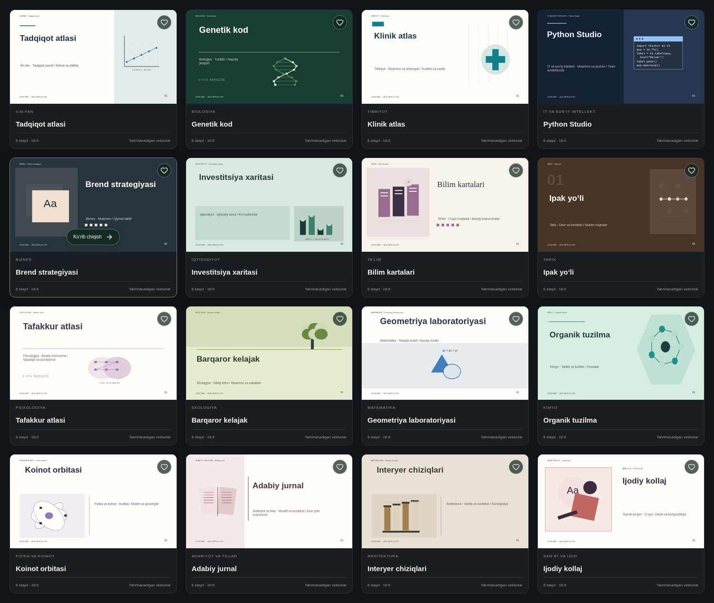

# Shablonlar katalogi

64 ta shablon, 16 yo‘nalish, har birida 6 ta tahrirlanadigan slayd. Ranglar bilan birga kompozitsiya, tipografika va mavzuli vektor motivlar farq qiladi.

## Qanday ishlatiladi

1. Ilovada **Shablonlar** bo‘limini oching.
2. Mavzuni kiriting yoki yo‘nalish bo‘yicha filtrlang.
3. Shablonni bosing, 6 ta slaydni ko‘rib chiqing.
4. **Shu shablonda yaratish** orqali loyiha oching. Har bir matn va vektorni tahrirlash mumkin.
5. Yoqqan variantni yurak belgisi bilan saralanganlarga saqlang.

Mavzu mosligi kalit so‘zlar bilan aniqlanadi: masalan, Python Tkinter → Python Studio, hujayra → Hujayra atlasi, yurak → Yurak ritmi. Moslik topilmaganda universal ilmiy maketlar taklif qilinadi. Bu AI fakt yaratish yoki manba tekshirish emas.

## Yo‘nalishlar

| Yo‘nalish              | Shablonlar                                                                           |
| ---------------------- | ------------------------------------------------------------------------------------ |
| Ilm-fan                | Tadqiqot atlasi · Laboratoriya jurnali · Ilmiy nigoh · Kashfiyot xaritasi            |
| Biologiya              | Hujayra atlasi · Genetik kod · Botanika daftari · Tirik tizimlar                     |
| Tibbiyot               | Klinik atlas · Yurak ritmi · Sog‘lom jamiyat · Farmatsevtika                         |
| IT va sun’iy intellekt | Python Studio · Neyron tarmoq · Raqamli mahsulot · Kiber terminal                    |
| Biznes                 | Startap sahnasi · Brend strategiyasi · Biznes arxitekturasi · Bozor hikoyasi         |
| Iqtisodiyot            | Moliya daftari · Iqtisodiy nigoh · Investitsiya xaritasi · Ma’lumot va iqtisod       |
| Ta’lim                 | Bilim yo‘li · Universitet kundaligi · Dars ustaxonasi · Bilim kartalari              |
| Tarix                  | Tarix solnomasi · Ipak yo‘li · Meros arxivi · Sivilizatsiyalar                       |
| Psixologiya            | Tafakkur atlasi · Inson va xulq · Xotira yo‘llari · Hissiy muvozanat                 |
| Ekologiya              | Yashil ufq · Iqlim va harakat · Barqaror kelajak · Yer daftari                       |
| Matematika             | Geometriya laboratoriyasi · Algebra maydoni · Statistik nigoh · Isbot daftari        |
| Kimyo                  | Molekulalar olami · Reaksiya laboratoriyasi · Organik tuzilma · Moddalar va xossalar |
| Fizika va koinot       | Koinot orbitasi · Energiya maydoni · Kvant daftari · Mexanika ustaxonasi             |
| Adabiyot va tillar     | Adabiy jurnal · Til ustaxonasi · She’riyat sahifalari · Hikoya tuzilishi             |
| Arxitektura            | Shahar chizmasi · Me’moriy shakl · Interyer chiziqlari · Tuzilmaviy nigoh            |
| San’at va ijod         | Ijodiy kollaj · Galereya · Musiqa ritmi · Dizayn manifesti                           |

## Kontent va eksport

- Mahalliy yaratish mavzuga mos reja va tahrirlanadigan ko‘rsatmalar beradi. Gemini sozlangach AI mazmuni shu dizaynlarga qo‘llanadi.
- AI yaratgan slayd soni, matn va spiker qaydlari saqlanadi; dizayn qo‘llash qo‘shimcha slayd hisoblamaydi.
- Yangi slayd qo‘shish tanlangan uslubni davom ettiradi.
- Vektorlar Canvas va PPTX’da mustaqil element sifatida qoladi. PPTX, PNG va PDF eksport mavjud.
- Shablonlar uchun hisob, AI kaliti yoki yangi SQL migratsiya kerak emas.
- Eski loyihalar va shaxsiy shablonlar saqlanadi.
